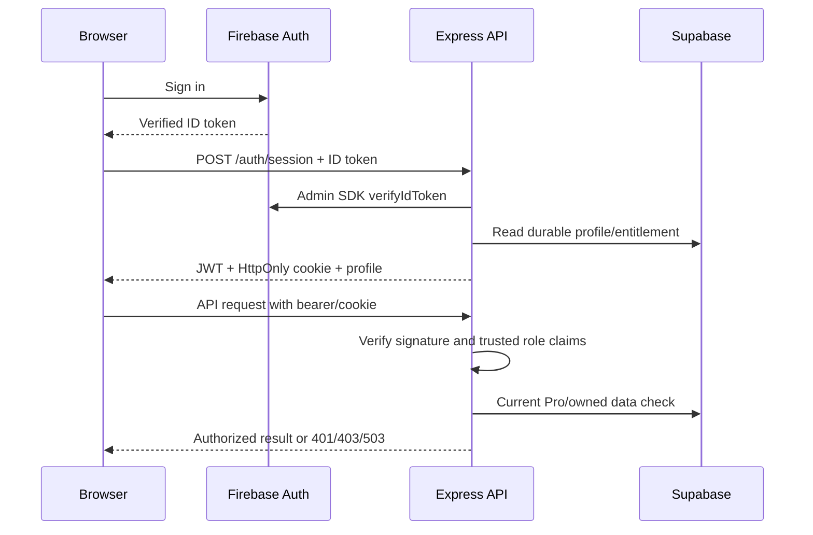
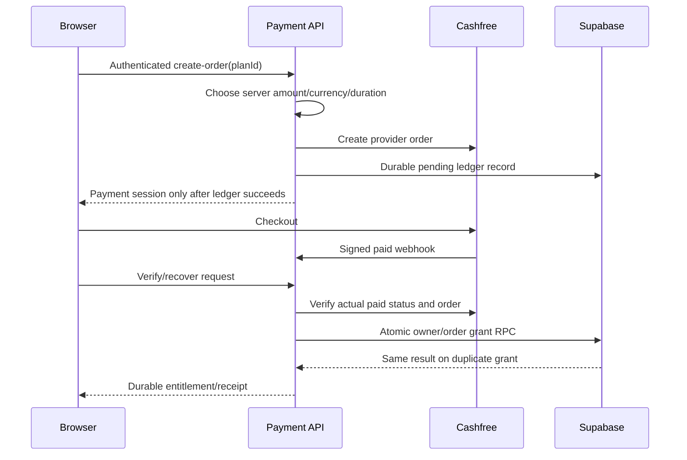
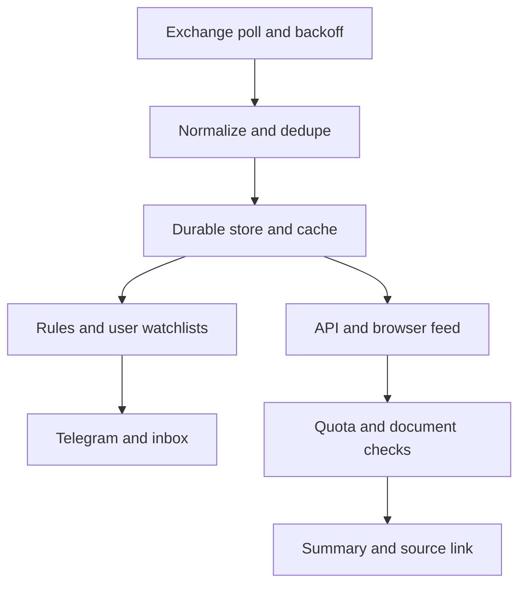

# System connections and change impact

## Major components

| Layer | Entry points / modules | Responsibility | Changes can affect |
|---|---|---|---|
| Browser shell | src/App.tsx, Layout.tsx, LandingPage.tsx | Path/tab routing, modal hosts, navigation, rendering | All pages, deep links, layout and guest/auth transitions |
| Browser identity | AuthContext.tsx, ModernAuthCard.tsx, firebase.ts, api.ts | Firebase login, session exchange, client cached display state, request authorization | All user-specific calls, trial/Pro UI, owner controls |
| API boundary | server.ts, server/security/auth.ts, server/api/routes.ts | Parse body/cookie, verify token, derive req.user, apply role/quota/rate gates | Every route using middleware; mounted routes inherit group guards |
| Payment boundary | api/payments.ts, config/plans.ts, paymentOrdersDao.ts, paymentEntitlementsDao.ts, paymentStore.ts | Server charges, verified provider status/signature, owner ledger, durable grant and reconciliation | Checkout, webhook, verify/recover/claim, paid access, receipt |
| User data | usersDao.ts, watchlistDao.ts, notesDao.ts, alertRulesDao.ts, notificationDao.ts | Verified UID ownership and per-user profile/lists/notes/preferences | Tenant isolation, quotas, alerts, sync/retention |
| Feed processing | services/bse.ts, monitor.ts, resultsCalendarService.ts, timelineClassifier.ts, announcementDao.ts | Poll, normalize, dedupe, store, classify and notify | Filing freshness, historic sync, stories, Telegram and source load |
| AI/document path | gemini.ts, aiQuotaService.ts, bseDocument.ts | Authenticated budget, document download/extraction, summary cache and generation | Gemini cost, SSRF, displayed provenance, paid/trial behavior |
| External data | marketIndicesService.ts, fiiDiiService.ts, stockNewsService.ts, storyFeedService.ts | Exchange/quote/RSS aggregation and cached data | Price/news/story accuracy and staleness |
| Delivery | telegram.ts, Telegram workers, notificationDao.ts | Shared channel vs personal chat, AI reply, retries, unread state | Audience separation, duplicates/loss, abusive dispatch |
| Persistence | database/supabase.ts, firebase.ts, localStore.ts | Supabase service client, legacy Firestore/storage mode, local cache/fallback | Restart safety, scaling, deployment configuration and migrations |

## Authentication request flow

Email/displayName/UID submitted in body do not define owner identity. Verified token email and emailVerified are used for owner. However, owner currently becomes admin directly, including a raw owner Firebase token: the PIN is not a required backend step-up. requireProOrAdmin checks current profile/paid entitlement rather than solely trusting stale JWT Pro claims; outages should return 503. Browser cached profile/role state controls display only and must never authorize server operations.

Credentials remain Firebase-managed; no application password is supposed to be stored in profile JSON. Server JWT signing secret and Firebase Admin service account are backend-only. JWT expires after 7 days; authToken cookie is HttpOnly, SameSite=Lax and Secure in production. The response also exposes the token to client code, and localStorage stores server/Firebase tokens in current flows. Those copies are readable by any successful same-origin script compromise. Logout clears the cookie/local client state but lacks durable server-token revocation. Firebase verifyIdToken(token,false) does not check revocation here.

## Credential and token ownership

| Item | Location/use | Exposure/required next check |
|---|---|---|
| Firebase browser configuration/API key | Client initialization | Public project identifier, not Admin private key. Inspect actual Auth authorized domains and rules live. |
| Firebase ID token | Firebase client; sent to server, sometimes cached in localStorage | Verify signed claims on every relevant request; avoid long-lived JS copies; sensitive operations should check revocation. |
| Server JWT | Signed by JWT_SECRET; cookie and bearer use | Secret needs entropy, rotation and session invalidation; frontend role cache cannot mint authority. |
| Firebase Admin credentials | server/security/firebaseAdmin.ts env parsing | Do not expose JSON/private key in client, logs, Git or report. Deployment presence/least privilege unverified. |
| Supabase service-role key | server/database/supabase.ts | Server only; bypasses RLS, so API must enforce ownership. Browser anon roles must not execute privileged RPCs. |
| Cashfree client secret | server/api/payments.ts env | Server only; browser gets payment session identifier, not provider secret. Verify exact sandbox/production mode live. |
| Gemini key | Server AI clients, env/settings source | Backend spending requires authorization/rate/budget controls; no public arbitrary generate route. |
| Telegram bot token | Server settings/env | Shared token serves different audiences; custom personal destination must never fall back to global chat. |
| reCAPTCHA/App Check token | Browser→verification helpers | Current enforcement is optional/readiness-dependent; UI badge is not proof every request was assessed. |

## Payment request flow

Code has server-side plan catalogue and raw webhook middleware before express.json. Review provider signature/time window, final paid event, exact plan/amount/currency and caller/order owner at each grant path. Current repository SQL cannot yet reproduce the intended atomic grant RPC. A HTTP success from UI mocks proves none of this. Test duplicate webhook, simultaneous verify/recover, interrupted grant, provider timeout, wrong user, amount mismatch, unpaid/pending/failed status, refund/revocation policy and restart with a sandbox order.

## Filing pipeline

Publication time, fetch time, durable-save time and paint/delivery time are distinct. Source request latency is not filing publication-to-screen latency. Redistributed cached data should retain source timestamps and say stale/unavailable if appropriate. Background history/news/stories should not starve the live feed or consume the entire external rate budget.

## Persistence and isolation

Firebase is identity; Supabase is current server data/payment persistence; legacy Firestore modules and local JSON remain in the tree. Presence of a Firestore module/rules does not prove it is the active production authority. Settings/storage mode/environment can change fallback behavior. Local Cloud Run files are per-instance and ephemeral. Notes enforce cloud-first writes and fail visibly on unavailable storage, with cached reads; notification/AI usage paths do not have the same durability contract. CSV storage references map call sites, not actual deployed tables or permissions.

User-facing requests must derive UID from verified req.user and then apply owner filters. `/api/seo/*` inherits requireAdmin+AI limiter at the mount; child route CSV rows list only their local middleware. Payments webhook is provider-signature authenticated in its handler, not user-session authenticated. Public FAQ/feedback/telemetry have separate flood/budget considerations; a route without requireAuth is not automatically a vulnerability.

## Change-impact workflow

1. Regenerate inventory at exact branch head. Read a changed file's imports and importedBy, then transitive reverse imports.
2. Search the exported symbol and string references with rg; include dynamic imports/reexports and route paths.
3. Trace HTTP destinations and server mounts; an import graph alone cannot connect browser fetch to an endpoint.
4. Trace DAO table/RPC keys, background schedules, shared cache invalidation and UI affordances.
5. Test affected role states, error/outage/race paths and route/device cases; write observed evidence and unknowns.
6. Run type check, appropriate tests/build, verify no dangling reference and preserve unrelated remote edits before non-force push.

Current map has zero unresolved literal local imports. Computed imports, aliases not used in this snapshot, generated assets, runtime configuration and database wiring are not proven by that count. Do not delete an apparently unimported file solely from this graph: service workers, public assets, server static routes and script entry points can be string referenced.
