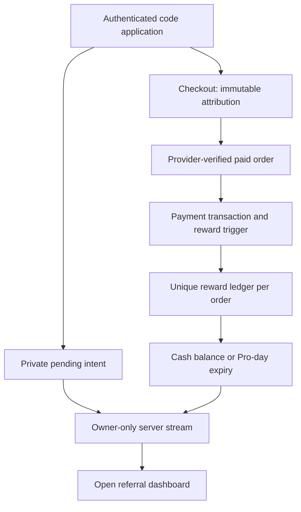

# Referral ownership, rewards and live updates

Baseline: main `4ec85ccadb3497cdfe2372c1eda8897b9bd35cad`. This branch preserves its prices and existing 14-day community / tiered creator reward policy.

## What identifies the referrer

The authenticated Firebase UID owns a database account. A normalized code is a unique, immutable alias pointing to that UID. `ALICE`, `alice`, and ` Alice ` address the same code. Two owners cannot claim it: the database primary key plus transactional owner check rejects the second claim with HTTP 409. There is no cache-only availability decision or ownership-changing upsert. Renaming retains old aliases, so already-shared links and pending orders still identify the original account. Inactive accounts do not accept new applications.

## What “used” means

| Event | Dashboard | Reward |
|---|---|---|
| Anonymous visitor opens link | Approximate click analytics | None |
| Signed-in friend applies a valid code | Pending application visible; repeat apply does not inflate it | None |
| Checkout created | Immutable order attribution binds buyer, owner, code, reward mode and exact amount | None |
| Provider-verified payment is durably granted | Confirmed ledger entry, counters and balance update | 14 community Pro days or creator commission |
| Duplicate webhook / verify / claim | Existing order result | No second reward |

A pending application is not a signup claim or a guaranteed purchase. Clearing an unconfirmed application removes that pending indication; it does not rewrite a previously bound checkout. Changing reward mode affects future checkouts, not promises already bound to an order. Click counts are not fraud-proof financial evidence. Repeat verified purchases retain the existing per-order reward policy; this change does not invent a first-purchase-only rule.

`referral_settle_order` locks attribution and owner records, verifies the granted order, and commits reward/counters/access together. A failure rolls back the paid-grant transaction rather than acknowledging a lost reward. Repeated callbacks see the existing unique reward. All four payment grant paths invoke the same idempotent settlement. Each checks provider amount against the durable checkout ledger, including referral discounts. A recordless historical order is not guessed into a valid referral; it needs audited recovery.

Community expiry has a separate durable floor (`referral_bonus_access_v2`) so an unrelated stale profile save cannot erase it. Existing paid entitlement expiry is extended while its payment provenance is preserved. A future refund/revocation implementation must adjust the reward ledger and this floor transactionally; automatic refund/clawback policy is outside this change.

## Live transport and privacy

The browser uses `customFetch` with the existing verified session/Firebase token to consume `/api/referrals/events`. No database key or UID from a query/header grants access. The API always reads the verified request UID. Public validation does not reveal the referrer's email, payout details or identity record.

Supabase Postgres Changes wakes the server when the owner account changes. The server then reads a private consistent snapshot and sends SSE. A 3-second reconciliation interval recovers missed events and works across instances even if Realtime is unavailable. This is near-real-time delivery, not a zero-latency guarantee. Streams expire after 55 seconds and reconnect through authentication; hidden/closed dashboards cancel their connections. Database failure marks updates delayed instead of replacing the last snapshot with invented zeroes. The browser does not reset input drafts on background snapshots.

Only service_role can execute referral RPCs or access these tables. Browser Supabase roles have no grants/RLS policy. SSE carries the referrer's own data; conversion rows use “Verified member” rather than exposing another person's email. Ledger display is explicitly limited to the latest 100 purchases; totals are all-time account counters.

## Deployment / legacy cutover — REQUIRED

This code has not been applied to a production database. Do not deploy the new runtime ahead of migration 006, and do not mix old local-cache writers with the new backend.

1. Export read-only schema definitions and privileges using `docs/audit/schema-contract.sql`. Verify the existing paid grant creates the modern `payment_orders` record (`status='granted'`, UID, plan, paise, currency) atomically with its paid entitlement. The old initial migration alone does not establish that contract.
2. Stop referral mutations/checkouts briefly and drain old application instances. Export `referral_codes`, `referral_conversions`, every available instance's `referrals.json`, `referral_conversions.json`, and `order_referrals.json`; back up user/payment entitlements and paid-order history. Local files may be absent after restart: do not claim that absence proves no liability.
3. Reconcile conflicting normalized codes with documented ownership evidence, canonical code/aliases per UID, balances/payout references, duplicate order IDs, and pending attribution. Identify old conversion entries whose Pro credit actually failed; do not treat the old “confirmed” flag as proof a benefit was delivered.
4. Prepare and review a deployment-specific import/backfill transaction into the v2 tables on a COPY. The migration intentionally raises `REFERRAL_LEGACY_REVIEW` for nonempty old tables; it is not a generic importer. Preserve archived originals. Do not empty or rename live tables merely to bypass this check. The cutover plan must explicitly account for every legacy row and local-only record before a reviewed migration variant can replace the guard.
5. For an empty/new referral deployment, run `006_durable_referrals.sql` as the database owner, inspect grants/triggers, and test service-role RPC access. For existing records, use the reviewed variant and reconciled import from step 4. Seed immutable aliases and historical reward order IDs without blindly issuing those rewards again. Preserve outstanding cash liabilities and independently verify previously granted free days.
6. Test duplicate/concurrent order callbacks, two owners requesting one code, server restart, network timeout after commit, payout replay, wrong-user requests, and stale profile updates on the deployment copy. SQL WASM tests in this PR do not replace real multi-connection/database integration or Cashfree sandbox testing.
7. Deploy the runtime, enable/verify the optional `supabase_realtime` publication for `referral_accounts_v2`, open dashboards in two authenticated accounts, apply and pay with the sandbox buyer, and verify pending → confirmed visibility and durable reward after restart. No real charge is needed for verification.
8. Rollback is coordinated: pause mutations, retain all v2/legacy data and reward obligations, and use the tested compatibility plan. Do not simply restore the old local-only backend while leaving payment triggers active. Never truncate the reward ledger to reset a test in production.

No migration, payout, notification or payment was performed against production during this work. Future work needs authorized database access to finish the deployment-specific reconciliation.

## Checks

- `npm run test:referrals`: actual PostgreSQL migration/function tests through pinned `@electric-sql/pglite`, plus API ownership/outage and payment/SSE contract tests. PGlite serializes connections; genuine multi-instance concurrency remains a deployment rehearsal requirement.
- `npm run lint`, `npm test` with a disposable test-only JWT secret, and `npm run build`.
- `npm run map:generate` / `npm run map:check` after editing these contracts.

Technical references checked for this design: [PostgreSQL constraints](https://www.postgresql.org/docs/current/ddl-constraints.html), [Supabase Postgres Changes](https://supabase.com/docs/guides/realtime/postgres-changes), [SSE](https://developer.mozilla.org/en-US/docs/Web/API/Server-sent_events/Using_server-sent_events). Database constraints enforce uniqueness; transport choice by itself does not secure or durably record a reward.
